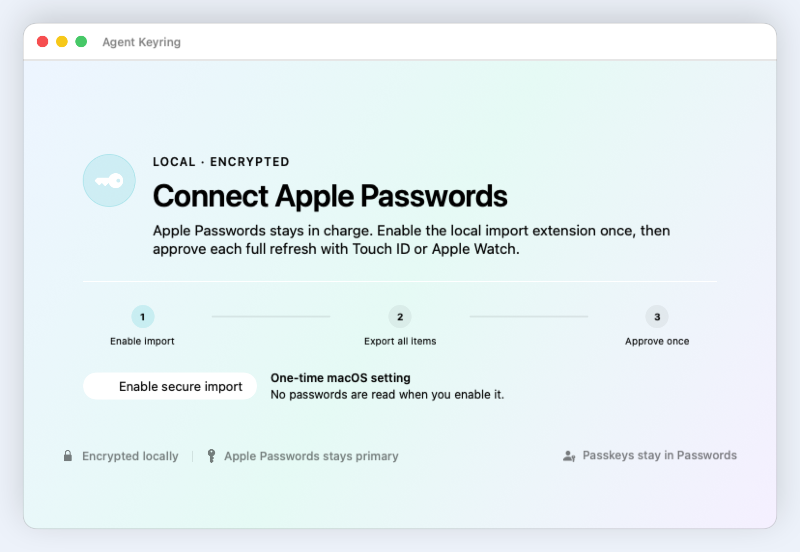
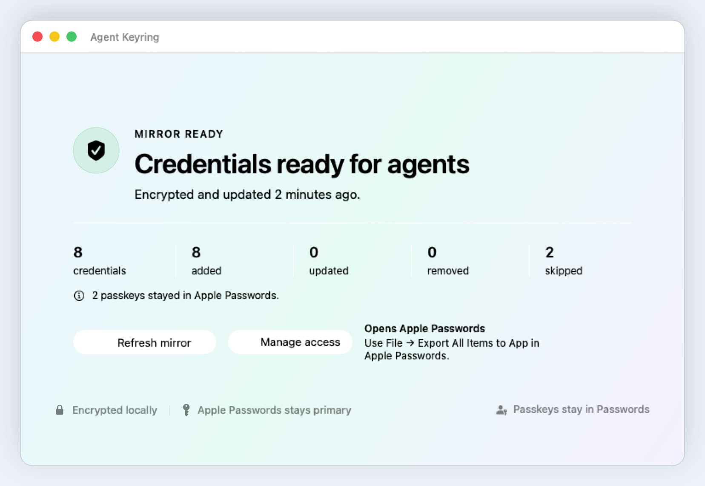
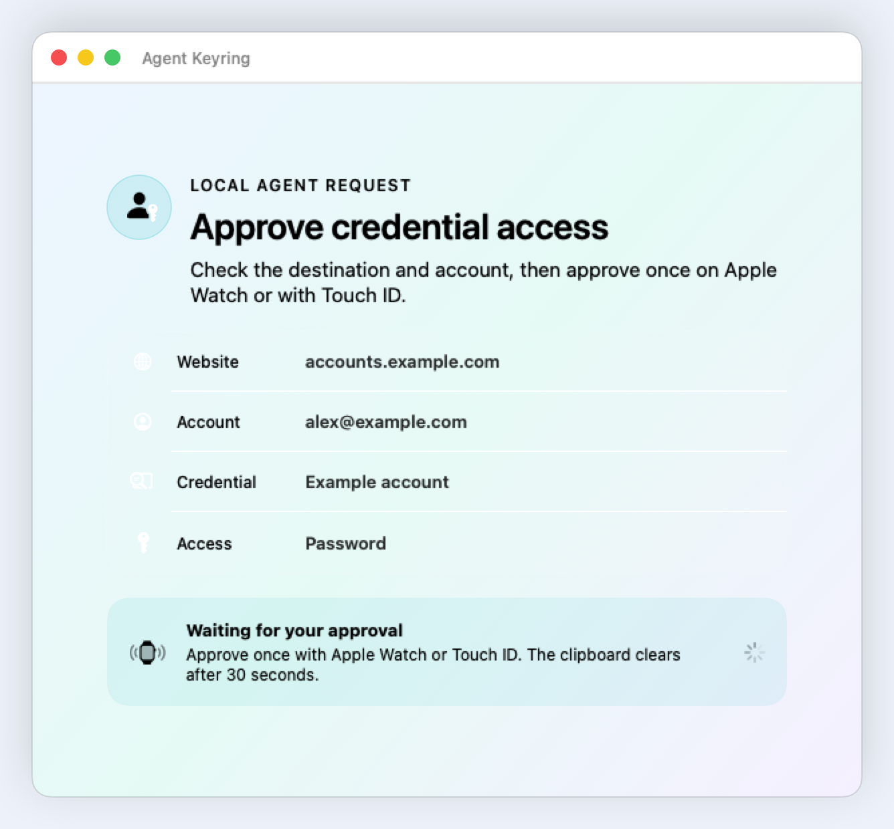

# Agent Keyring

Agent Keyring lets local AI agents use usernames, passwords and verification codes from Apple Passwords without printing secrets in command output. Apple Passwords remains the source of truth.

[](docs/media/agent-keyring-demo.mp4)

Select the demo to open the 18-second MP4. Every screenshot and demo credential uses synthetic data.

## Before you start

Agent Keyring is a developer preview. There is no prebuilt download yet.

You need:

- macOS 26
- Xcode 27
- a paid Apple Developer Program team that can sign the AutoFill Credential Provider entitlement
- Apple Passwords as your password manager

Passkeys are not supported. They remain in Apple Passwords and continue to use Apple's normal flow.

## What Agent Keyring does

Agent Keyring has 3 local parts:

- a signed macOS app receives a full export from Apple Passwords and stores an encrypted mirror
- the `agent-keyring` command resolves a credential by HTTPS origin and copies one field to the pasteboard
- a bundled Codex skill tells agents how to use the command without reading or printing the secret

Passwords and TOTP seeds use AES-GCM encryption at rest. The encryption key stays in the login Keychain. Agent Keyring clears its own pasteboard value after 30 seconds.

## Install from source

1. Clone the repository.

   ```sh
   git clone https://github.com/joshp123/agent-keyring.git
   cd agent-keyring
   ```

2. Create your local signing configuration.

   ```sh
   cp Config/Local.xcconfig.example Config/Local.xcconfig
   ```

3. Set your own bundle ID prefix and Apple Developer team ID in `Config/Local.xcconfig`.

   ```text
   AGENT_KEYRING_BUNDLE_ID_PREFIX = com.example
   AGENT_KEYRING_TEAM_ID = YOUR_TEAM_ID
   ```

4. Build, sign, install and verify Agent Keyring.

   ```sh
   ./script/build_and_run.sh --verify
   ```

The script installs:

- `/Applications/AgentKeyring.app`
- `~/.local/bin/agent-keyring`
- `~/.codex/skills/agent-keyring`

Restart Codex after the first installation so it discovers the skill.

## Connect Apple Passwords



1. Open Agent Keyring and select `Enable secure import` once.
2. Open Apple Passwords.
3. Select `File`, then `Export All Items to App`.
4. Select Agent Keyring.
5. Approve the full export once with Touch ID or Apple Watch.

Use `Export All Items to App` for every normal refresh. A selected-item export is not a complete mirror.

Apple excludes some records before Agent Keyring receives the export. These can include passkeys, Sign in with Apple entries, credentials shared by someone else and records without a usable password. Agent Keyring reports the skipped count after each refresh.



## Choose what agents may use

Open Agent Keyring and select `Manage access`.


Every credential has one rule:

| Rule | What happens |
| --- | --- |
| Ask each time | Usernames are available. Passwords and verification codes need Touch ID or Apple Watch. |
| Allow automatically | Any process running as your macOS user can copy the credential without a prompt. |
| Blocked | Local agents cannot copy any field from the credential. |

New credentials start in `Ask each time`. Rules use stable credential IDs, so they survive a full refresh.

### Let a model suggest the rules

Select `Let AI choose` if you do not want to classify every credential yourself.


1. Copy the generated prompt into your preferred model.
2. Answer its questions about unattended tasks and sensitive accounts.
3. Paste its final response back into Agent Keyring.
4. Review every proposed change, then apply it.

The prompt includes credential IDs, titles, websites, account labels and current rules. It never includes passwords, TOTP seeds or verification codes. Pasting the prompt shares that metadata with the model provider you choose.

Agent Keyring rejects malformed responses and any response with missing, duplicated or unknown credential IDs.

## Ask Codex to do the task normally

After installation, ask Codex for the outcome you want. For example:

> Sign in to example.com and download my latest invoice.

When Codex reaches a login, the installed skill tells it to resolve the current HTTPS origin and request the required field. The secret moves through the pasteboard and never appears in command output or chat.

An `Ask each time` rule shows the destination, account, credential and requested field before macOS asks for approval.



Approve once with Touch ID or Apple Watch. Agent Keyring then copies the requested field for the waiting agent.

## Use the command directly

All commands return JSON with safe metadata and receipts. Secret values never appear in standard output or standard error.

```sh
agent-keyring status
agent-keyring resolve --url 'https://example.com/login'
agent-keyring copy --url 'https://example.com/login' --field username
agent-keyring copy --url 'https://example.com/login' --field password
agent-keyring copy --url 'https://example.com/login' --field totp
```

If several accounts match, narrow the request with `--username` or a candidate UUID returned by `resolve`. Agent Keyring does not guess between accounts.

## Refresh behaviour

Apple does not provide silent background export or an incremental change feed.

Agent Keyring can tell when its mirror is old. It cannot discover an unseen password change inside Apple Passwords. Refresh the mirror by repeating `File`, `Export All Items to App` and approving once.

Each complete refresh reports credentials added, changed, removed and skipped.

## Security boundaries

- the agent states the destination URL because Safari and Codex do not provide an attested active-tab origin
- access rules apply per credential, not per agent or calling app
- `Allow automatically` trusts every process running as the unlocked macOS user
- anyone who controls that macOS user account is inside the current trust boundary
- the browser handoff uses a short-lived pasteboard value
- passkeys remain outside Agent Keyring
- the encrypted mirror is local and Apple Passwords is never modified

## Current limits

- no passkey support
- no silent or incremental Apple Passwords sync
- no per-agent identity or per-app rules
- no signed binary release for other users yet
- macOS 26 and an eligible Apple Developer Program team are required

## Develop and test

Run the package tests:

```sh
swift test --package-path ./AgentKeyringPackage
```

Regenerate the synthetic README screenshots, MP4 and GIF without opening the app:

```sh
./script/render_readme_media.sh
```

The media script needs `ffmpeg`. Its renderer uses an off-screen window with a prohibited activation policy, so it cannot take keyboard focus.

## Licence

Agent Keyring uses the MIT Licence. See [LICENSE](LICENSE).
