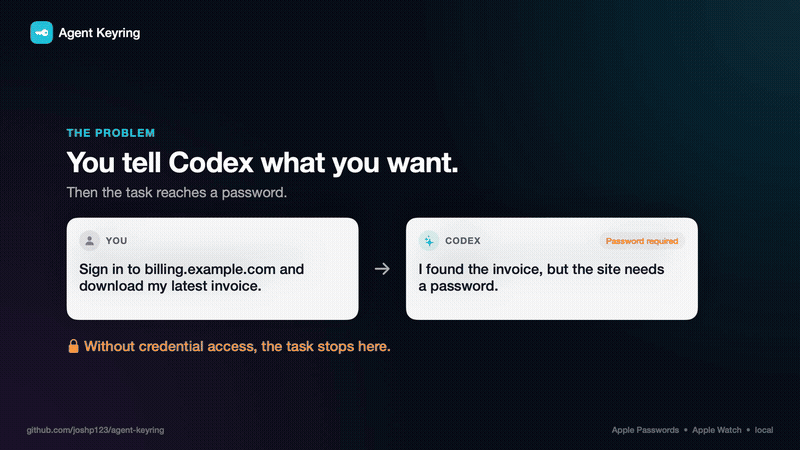
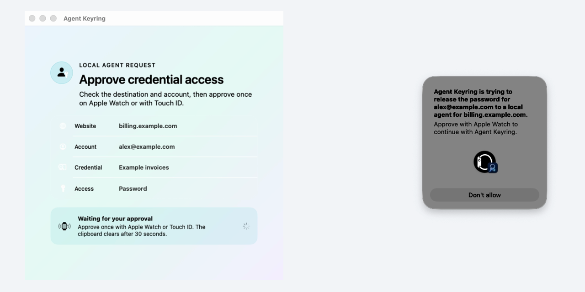
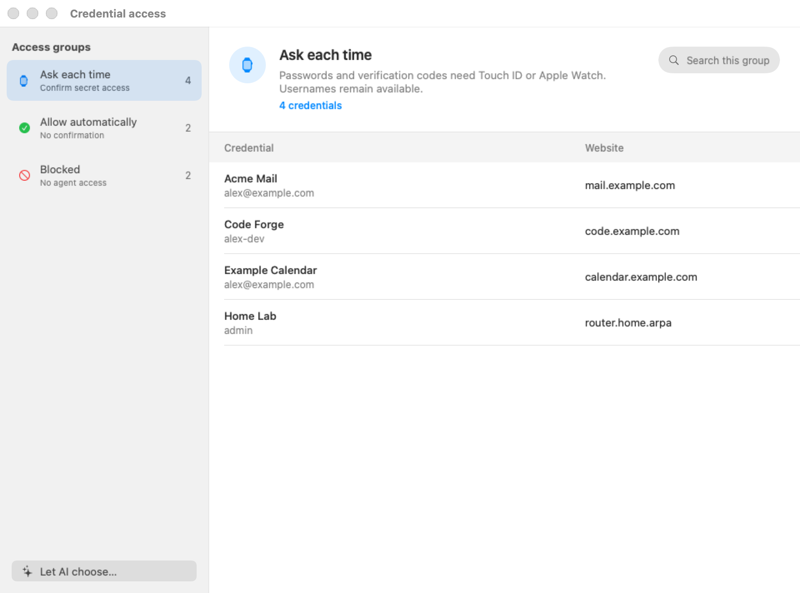
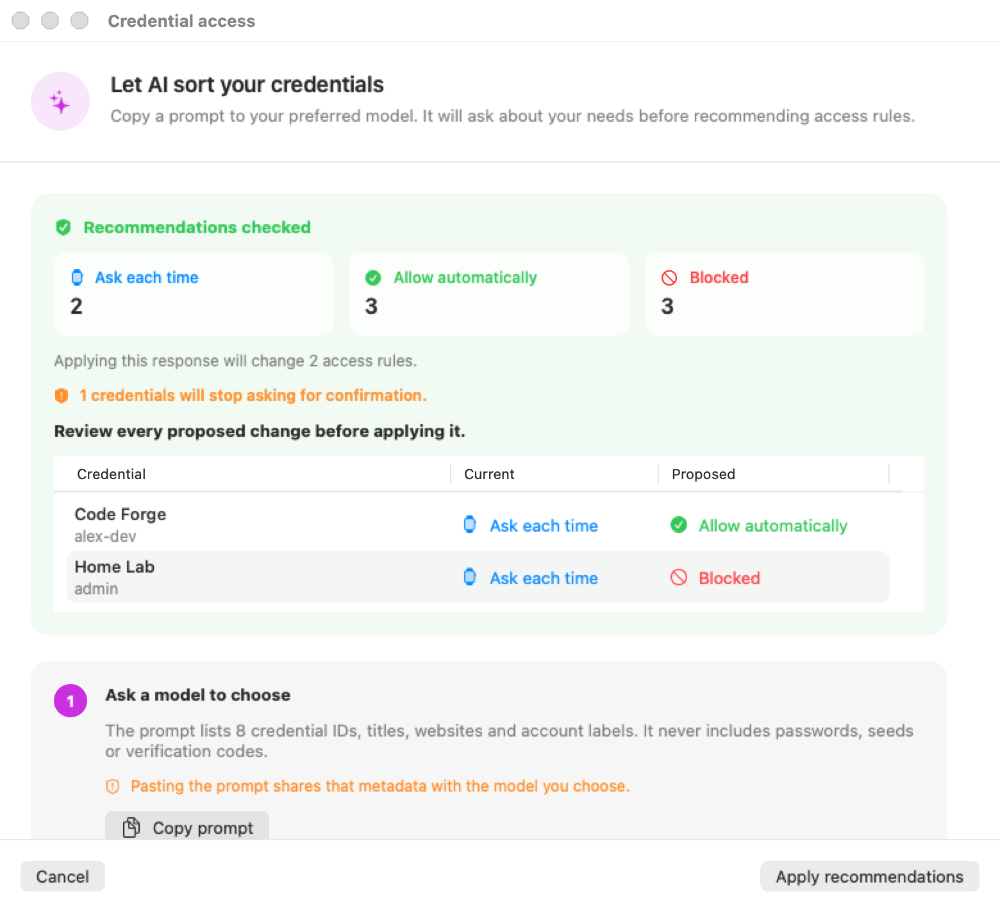

# Agent Keyring

Let Codex sign in for you without moving your passwords out of Apple Passwords.

Agent Keyring keeps an encrypted local mirror, gives agents only the credentials you allow and asks on Apple Watch or Touch ID before releasing protected passwords.

[](docs/media/agent-keyring-demo.mp4)

Demo data is synthetic. Product screens are rendered off-screen from the real SwiftUI views. The Watch prompt is a genuine macOS prompt captured separately, not a recording of completed approval.

## Download

[Download the latest release](https://github.com/joshp123/agent-keyring/releases/latest)

You need macOS 26 or later and Apple Passwords. The app is signed and notarised. Agent Keyring is free, open source and has no account or subscription.

1. Unzip Agent Keyring and move it to Applications.
2. Run `/Applications/AgentKeyring.app/Contents/Helpers/agent-keyring install` in Terminal, then restart Codex once.
3. Open Agent Keyring and select `Enable secure import`.
4. In Apple Passwords, choose `File` → `Export All Items to App` → `Agent Keyring`, then approve once.

Repeat step 4 when you want to refresh the mirror. Apple does not provide silent or incremental password export.

## Why it exists

Codex can use Safari and its built-in browser, but it cannot read Apple Passwords when a login appears. Agent Keyring adds a narrow local hand-off:

- Apple Passwords stays the source of truth
- the mirror is encrypted with a key in your login Keychain
- secrets never appear in command output or chat
- approved secrets use the shared macOS pasteboard, where other processes in your user session can read them until Agent Keyring clears its value after 30 seconds

## Approval on Apple Watch

For protected credentials, Agent Keyring shows the exact website, account and requested field before macOS asks for approval.



One Apple Watch or Touch ID approval releases one requested field. The request expires if the agent goes away.

## Choose what agents can use

Each credential has one rule:

| Rule | Result |
| --- | --- |
| Ask each time | Usernames are available. Passwords and codes need Apple Watch or Touch ID. |
| Allow automatically | Any process running as your macOS user can copy the credential. |
| Blocked | Local agents cannot copy any field. |

New credentials start in `Ask each time`.

<p>
  
  
</p>

Select `Let AI choose` if you do not want to sort everything yourself. Agent Keyring creates a prompt for any model. The model first asks about your tasks and risk preferences, then returns a rule for every credential. You review every change before applying it.

The prompt contains credential names, sites and account labels. It never contains passwords or verification codes.

## Security limits

- passkeys stay in Apple Passwords and are not supported yet
- Apple may omit shared credentials, Sign in with Apple records and items without passwords
- Agent Keyring cannot detect a password changed in Apple Passwords until you refresh
- `Allow automatically` trusts every process running as your unlocked macOS user
- the agent states its destination URL because browsers do not provide Agent Keyring with an attested active-tab origin
- using `Let AI choose` shares non-secret credential metadata with the model you choose

Sparkle checks this repository for signed updates. Automatic installation is off.

## Build from source

You need Xcode 27 and an Apple Developer team with the AutoFill Credential Provider capability.

```sh
git clone https://github.com/joshp123/agent-keyring.git
cd agent-keyring
cp Config/Local.xcconfig.example Config/Local.xcconfig
./script/build_and_run.sh --verify
```

Run the tests with `swift test --package-path AgentKeyringPackage`.

## Licence

MIT. See [LICENSE](LICENSE).
